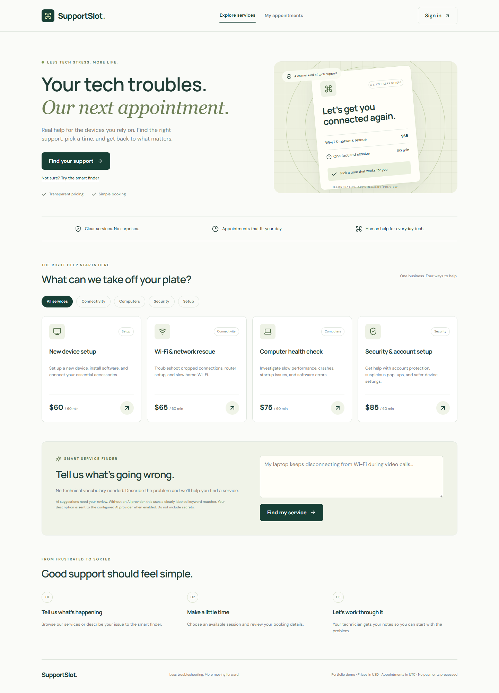

# SupportSlot

An IT service booking application built with React, Vite, Node.js, Express, and MongoDB. Customers can register, browse four support services, request a service recommendation, reserve an appointment, and cancel upcoming bookings. Administrators can review all appointments and mark started sessions completed.

This is a runnable capstone foundation. To satisfy the AI requirement, configure and verify a real AI provider; keyword fallback is explicitly **not AI**. Public deployment and your own development history are still required.

## Start here

Read [START-HERE.md](START-HERE.md) for Windows and VS Code setup, then [docs/LEARNING-GUIDE.md](docs/LEARNING-GUIDE.md) for the code walkthrough. [docs/PROJECT-SPEC.md](docs/PROJECT-SPEC.md) contains the scope, user stories, architecture, data model, wireframes, and limitations. [docs/TESTING.md](docs/TESTING.md) explains verification. [docs/DEPLOYMENT.md](docs/DEPLOYMENT.md) explains publishing. [docs/GITHUB.md](docs/GITHUB.md) explains uploading the project.

## Requirements

- Node.js 22.12+ (24 LTS recommended) and npm.
- MongoDB locally or a MongoDB Atlas connection string.
- Optional OpenAI-compatible AI chat endpoint, key, and model from your provider.

## Quick start

From this directory in PowerShell:

```powershell
npm.cmd ci
Copy-Item server/.env.example server/.env
# Edit server/.env: set MONGODB_URI and a unique JWT_SECRET.
npm.cmd run seed
npm.cmd run dev
```

Open the local URL printed by Vite (normally http://127.0.0.1:5173). Create your own customer account. There are no hardcoded login credentials. To create an admin, set ADMIN_EMAIL and ADMIN_PASSWORD in server/.env before seeding; an existing account is never promoted automatically.

## Commands

| Command | Purpose |
| --- | --- |
| `npm run dev` | Frontend and API development servers |
| `npm run seed` | Upsert the catalog and optionally create an admin |
| `npm test` | Integration tests using an isolated temporary MongoDB |
| `npm run build` | Build the React frontend |
| `npm start` | Serve the API and built frontend together |

Production environment variables are supplied by your hosting provider. For local production-preview startup: `node --env-file=server/.env server/src/index.js` after building. Keep NODE_ENV=development for local HTTP, because production cookies require HTTPS.

## How it works

React uses relative `/api` URLs. Vite proxies those requests to Express in development. In production Express serves the frontend build, preserving one origin for secure cookie authentication. Passwords are bcrypt-hashed; the session is an eight-hour signed JWT in an HttpOnly cookie. Roles are checked in the backend, never trusted from the client.

One technician has eight one-hour weekday slots, 13:00–21:00 UTC, within the next 30 days. A MongoDB partial unique index prevents concurrent active reservations for the same start time. All services take exactly one hour. This deliberately avoids claiming to support arbitrary overlapping service durations.

The AI receives the customer's description and the service catalog and returns a catalog service ID, explanation, and intake summary. Its output is schema-checked and restricted to existing service IDs. The backend validates bookings independently. A model cannot set prices, invent slots, or book anything. Review the summary before submission. React renders provider text as plain text.

## Project layout

```text
client/src/
  components/       UI forms, service cards, assistant, dashboard
  App.jsx           Screen navigation and session state
  api.js            HTTP helper and UTC formatting
  styles.css        Responsive design
server/src/
  middleware/       Authentication and role checks
  routes/           Authentication and booking endpoints
  services/         Scheduling rules and AI integration
  models.js         Mongoose schemas and reservation index
  app.js            Middleware, endpoints, production static serving
  index.js          Database connection and server startup
  seed.js           Non-destructive catalog/admin initialization
server/test/        Database-backed integration tests
docs/               Setup, specification, testing, deployment, learning
.github/workflows/  Continuous integration
```

## Environment variables

See server/.env.example. MONGODB_URI and JWT_SECRET are required to start. AI_CHAT_URL, AI_API_KEY, and AI_MODEL are optional as a group; without them the UI labels its non-AI fallback. Never put provider keys in frontend code or VITE_ variables. Descriptions are sent to the configured provider when AI is enabled; use fictional information in public demos.

## API overview

`POST /api/auth/register`, `POST /api/auth/login`, `POST /api/auth/logout`, `GET /api/auth/me`, `GET /api/services`, `GET /api/slots?date=YYYY-MM-DD`, `POST /api/recommend`, `GET /api/bookings`, `POST /api/bookings`, `PATCH /api/bookings/:id/cancel`, `PATCH /api/bookings/:id/complete` (admin), `GET /api/health`.

## Current boundaries and future work

No payments, email reminders, password reset, rescheduling, staff availability editor, or service catalog editor. Cancel and rebook to change an appointment (these are separate operations). No multi-business support or multiple technicians. Sessions are not centrally revocable; logout removes the browser cookie. The public AI endpoint is rate-limited in process; add distributed quotas and a provider budget before larger public use. The navigation uses React state rather than persistent page URLs. Google Fonts is optional; system fallbacks work without it. Add your own screenshots and live deployment URL after running the app. No live hosting account, database credentials, or AI key are bundled.

## AI use during development

This starter was generated with AI assistance. Before submitting, understand and review each module, run the checks, document your own changes, and record how AI helped. Automated integration tests mock the external model provider; they do not prove the accuracy of a real configured model.

## Portfolio description

“Built SupportSlot, a full-stack IT service booking application with React, Express, and MongoDB. Implemented cookie-based authentication, role-based authorization, concurrent booking protection, and catalog-grounded AI recommendations with validated outputs and graceful fallback.”

Use this wording only once you have run, understood, and verified those capabilities. Add only measured outcomes, your real contributions, and your own name.

## Preview



[Mobile preview](docs/screenshots/mobile.png) · [Verification record](docs/VERIFICATION.md)
