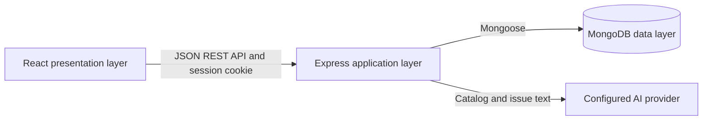

# SupportSlot project specification

## Problem and target users

People with everyday IT problems often do not know which service to book. SupportSlot helps individual customers choose support and reserve a session with a single IT service business. Administrators review the appointment queue. This project deliberately uses fictional appointments and processes no payments.

## Scope

Implemented: registration/login/logout, customer/admin authorization, catalog and category filtering, availability, booking/cancellation, customer and admin dashboards, started-session completion, optional live AI recommendation and summary, explicit keyword fallback, responsive UI, backend validation, tests, CI, and setup documentation.

Future: technician role, email confirmations, password recovery, rescheduling as one transaction, editable services and availability, timezone localization, audit events, distributed quotas, provider cost dashboard, accessibility review with real users. These are not implemented promises.

## User stories and acceptance criteria

| Story | Acceptance |
| --- | --- |
| As a customer, I can register | Valid input creates a hashed-password account; duplicate email returns 409 |
| As a customer, I can sign in | Valid credentials issue an HttpOnly cookie; invalid credentials fail |
| As a customer, I can select help | Four catalog services show descriptions, categories, duration, price |
| As a customer, I can describe a problem | Live AI returns a validated catalog service or no match; failures are labeled fallback |
| As a customer, I can reserve a session | Only server-generated slots are accepted; concurrent reservations yield one winner |
| As a customer, I can manage bookings | Only my records appear; I can cancel my future confirmed appointments |
| As an admin, I can manage the queue | All bookings appear; started confirmed appointments can be completed |
| As a visitor on a phone, I can use the app | Navigation, forms, cards, and dashboards fit narrow widths |

## Architecture



Development: Vite proxies /api to Express. Production: Express serves the built frontend and API from one HTTPS origin. No secrets are sent to the browser. Middleware handles transport limits, security headers, session checks, role checks, and consistent error responses. Routes handle HTTP orchestration; services contain scheduling and recommendation rules; Mongoose models define persistence.

## Data model

User: name, unique normalized email, passwordHash (excluded by default), role, timestamps.

Service: unique slug, name, category, description, price (USD), duration (60), keyword list.

Booking: user reference, service reference, startsAt UTC date, notes, status, timestamps. A partial unique index on startsAt for confirmed/completed status prevents two active reservations. Cancelled records remain for history and release their slot. Seed is non-destructive; editing seeded catalog prices changes displayed service prices, so production billing would require booking price snapshots before adding payments.

## Wireframes and component plan

```text
HOME
[Brand]       [Explore services] [My appointments]       [Sign in]
[Headline + action]                      [Appointment illustration]
[Benefits]
[Categories] [Service card] [Service card] [Service card] [Service card]
[Smart finder explanation]                [Issue form + result]
[Three-step explanation]

BOOKING
[Service name / price / duration]
[UTC date] [Available UTC slot]
[Editable intake notes]
[Confirm appointment]

DASHBOARD
[Welcome / admin title]
[Service | status | UTC time | notes | Cancel / Complete]
```

App owns session, selected service, and screen state. AuthForm owns account inputs. ServiceCard displays reusable catalog records. BookingForm loads availability and submits reservations. Assistant owns recommendation input/result. Dashboard loads authorized records and invokes permitted actions. api.js centralizes fetch behavior.

## AI design and limitations

Catalog-grounded classification and intake summarization use the provider's chat completions endpoint with JSON output. Zod checks its shape; the selected service ID must exist. This is direct catalog grounding, not a vector database or a RAG pipeline. Model text is advisory and may be wrong. Prompt instructions are a defense layer, not a proof against prompt injection. The model never invokes booking APIs, sets prices, or supplies available times. The customer reviews and confirms independently. Descriptions go to the provider when enabled; use fictional demo input.

## Nonfunctional goals and checks

Authorization: ownership enforced in database queries, admin role read from database. Booking integrity: unique index and integration concurrency test. Input quality: Zod validation and body limits. Reliability: AI timeout/fallback, user-facing empty/error states. Accessibility baseline: semantic controls, labels, keyboard focus, skip link, reduced-motion support. Manual keyboard/screen-reader testing remains required. Maintainability: component/route/service/model separation. No performance or uptime measurements are claimed.

## SDLC evidence and submission

Planning and requirements: this specification. Design: wireframes, component plan, architecture, schemas. Implementation: source files. Testing: automated suite and manual test log you complete. Deployment: follow deployment guide and record live URL. Submission: repository URL, live URL, README, and Word/PDF documentation required by your capstone. This Markdown specification is source material for that final document, not the required final Word/PDF itself. Maintain at least 15 genuine development commits; do not fabricate history.
